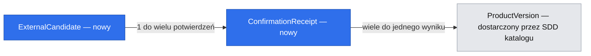

# E01 — rozpoznanie kodu i potwierdzenie produktu

Data: 2026-10-20. Status: SDD do review, bez implementacji. Source issues: #20 i #25.
Zależności: [katalog](2026-10-20-e01-product-catalog.md),
[iOS](2026-10-20-e01-ios-product-foundations.md) dla części skanera.
Mapa: [fundamenty](2026-10-20-e01-reusable-foundations.md).

## 📝 TLDR

Ten sam skan ma najpierw zwracać zapamiętany lokalny produkt. Pierwszy wynik dostawcy jest
kandydatem do korekty i potwierdzenia, a brak produktu umożliwia ręczne uzupełnienie.
Backend i flow aparatu dostarczają jedną spójną możliwość; sam aparat nie tworzy spożycia.
Q1 split potwierdzony. ADR-0007/0008 wyznaczają reguły; nie ma nowego pytania produktowego.

## 📝 Architecture i kontrakty

product.api.ResolveBarcode.resolve(Gtin) zwraca lokalny ProductSnapshot, ExternalCandidate
albo NotFound; niedostępność i limit są typowanymi wynikami błędu aplikacyjnego.
ProductCatalog pozostaje lokalnym odczytem — nigdy nie uruchamia zewnętrznego importu.
Prywatny ExternalProductProvider w product.application.port.out zwraca typy Mealio,
nie DTO Open Food Facts. Adaptery są w product.infrastructure.provider.

Orkiestracja: lokalny zatwierdzony produkt -> Open Food Facts -> opcjonalny skonfigurowany
FatSecret tylko po NOT_FOUND -> ręczny formularz. Brak FatSecret to pełnoprawne MVP.
Awaria/limit nie oznacza braku; nie uruchamia cichego łańcucha maskującego problem.
Zewnętrzne HTTP odbywa się poza transakcją zapisu. Odczyty lokalne są niezależne od dostępności OFF.

OFF adapter używa API v3 i minimalnych fields oraz własnego User-Agent. Request timeout,
limiter i retry-after są konfiguracją. Bez agresywnego automatycznego retry: 429 honoruje
retry-after, 5xx/sieć mają ograniczone ponowienie tylko odczytu, brak retry walidacji.
Operacyjne limity i licencje sprawdzić ponownie przed wdrożeniem; są w notatce research,
a nie zakodowane w domenie. Adapter ma bazowy host w konfiguracji i odrzuca nieoczekiwany
redirect zamiast przekazywać nagłówki/parametry do innego hosta.

## 📝 Data Model

Właściciel nowych tabel/migracji: product. Katalog i rewizje pozostają z SDD #13.

| Nowy rekord | Znaczenie i ograniczenia |
|---|---|
| ExternalCandidate | UUID, kanoniczny GTIN, revision > 0, expiresAt, zmapowane pola i pochodzenie; nie jest ProductVersion |
| ConfirmationReceipt | UUID idempotencyKey unikalny, hash tożsamości operacji, candidateId, expectedRevision, wynik productId/versionId, completedAt |

Candidate TTL domyślnie 24h, receipt minimum 24h — konfiguracja operacyjna; czas wstrzyknięty
Clock. Przechowujemy tylko dozwolone pola produktu i źródła, bez pełnego JSON/zdjęć/danych
autorów. Kandydat ma własny snapshot, aby potwierdzenie odnosiło się do danych obejrzanych,
a nie nowej odpowiedzi dostawcy. Ponowny odczyt dostawcy tworzy nowy candidateId, nie zmienia obejrzanego snapshotu.

Kolor istniejący oznacza zależność wymaganą przed realizacją skanera, nie dzisiejszy stan main.
Po upływie TTL kandydat bez receipt może zostać usunięty. Kandydat z receipt pozostaje co najmniej
przez retencję receipt; usuwanie kolejno receipt -> osierocony candidate. Wynikowy ProductVersion
nie jest usuwany razem z nimi. Nie zapisujemy userId ani historii skanów w logach.

## 📝 API Contracts

POST /api/v1/products/resolve-barcode, request { gtin: "..." }.

200 z rozłącznym kind:

- LOCAL_PRODUCT: trwały snapshot i versionId, bez potrzeby ponownego potwierdzenia.
- EXTERNAL_CANDIDATE: candidateId, revision, expiresAt, pola, warnings i provenance.
- NOT_FOUND: kanoniczny GTIN i możliwość ręcznego formularza.

400 INVALID_GTIN, 429 PROVIDER_RATE_LIMITED z retryAfter, 503 PROVIDER_UNAVAILABLE.
Błędny GTIN nie wywołuje dostawcy. Formaty liczb i błędów są zgodne z mapą/katalogiem.

POST /api/v1/product-candidates/{id}/confirm: expectedRevision, correctedFields jako
pełny ProductDraft z SDD katalogu oraz wymagany Idempotency-Key UUID w header.
Wymagana nazwa i basis, opcjonalna marka, cztery opcjonalne fakty i konwersja;
pominięte/null pole opcjonalne oznacza brak, nie zachowanie pola kandydata. Formularz
zaczyna od jego danych, lecz wysyła cały poprawiony stan. Nie wolno przesłać/zmienić
GTIN, źródła lub statusu; GTIN i pochodzenie pochodzą z niezmiennego kandydata. 201 dla pierwszego zapisu,
200 dla powtórzenia z tym samym kluczem i payloadem; oba zwracają ten sam productId/versionId.
Tożsamość operacji obejmuje candidateId ze ścieżki, expectedRevision i cały
kanoniczny ProductDraft (jednostki i liczby normalizowane, kolejność pól JSON nieistotna,
brak i null zgodne z semantyką draftu). Hash obejmuje całą tę tożsamość.
Inny kandydat, rewizja lub draft przy tym samym kluczu: 409 IDEMPOTENCY_CONFLICT. Nieaktualna rewizja:
409 CANDIDATE_VERSION_CONFLICT; wygasły kandydat: 410 CANDIDATE_EXPIRED; brak: 404.

Potwierdzenie korzysta z wewnętrznego ProductRegistration z #13 i transakcyjnie
tworzy produkt/wersję/konwersje/receipt. Nie wywołuje kontrolera ani endpointu POST /products. Receipt lookup poprzedza
sprawdzenie wygaśnięcia, aby zakończone potwierdzenie można odtworzyć po wygaśnięciu kandydata.
Unique GTIN i unique key chronią równoległy zapis. Konkurencyjny inny klucz dla zajętego GTIN:
409 PRODUCT_GTIN_CONFLICT z istniejącym odwołaniem; nie nadpisujemy cudzej korekty.
Nieudane transakcje nie pozostawiają receipt sukcesu. Klient zachowuje klucz przy retry tej samej
próby i zmienia dopiero dla innego potwierdzanego payloadu.

Ręczny fallback korzysta z POST /products z SDD #13, zachowując GTIN, źródło USER_LABEL
i brakujące wartości. Nie dodajemy obowiązkowego OCR. Aktualizacja źródła nie nadpisuje
lokalnej wersji — jawne odświeżenie pozostaje osobnym późniejszym przypadkiem użycia.

## 📝 UI/UX

Features/Barcode ma BarcodeScanner port i systemowy adapter aparatu. Adapter emituje kod,
nie zapisuje produktu. Flow prowadzi resolution/confirmation; ProductSelection wraca do hosta.
Tryb ręcznego wpisania kodu jest dostępny przy braku aparatu lub odmowie uprawnienia.
Obsługa isSupported/isAvailable, odmowy/utraty dostępności, anulowania, błędu kodu oraz
zatrzymanie skanowania po pojedynczym odczycie zapobiega serii lookupów jednej etykiety.

Lokalny wynik wraca od razu; kandydat pokazuje dane i umożliwia korektę. Formularz używa
FormField/QuantityInput/NutritionSummary/SubmitState z foundations; brak/timeout/429 mają
odrębne stany. Wyjście anuluje odczyt i sprawdza generację odpowiedzi; po potwierdzeniu
wraca trwały produkt. Po niejednoznacznym błędzie confirmation retry używa tego samego klucza.
Wspólny flow obsługuje wejście z dziennika lub przepisu, bez implementowania ich zapisu w skanerze.

## 📝 Risks & Impact Review

Spring wiring i krótkie transakcje są adapterami infrastruktury opisanymi w mapie;
porty/use cases/domain product pozostają bez Springa. Adapter HTTP dostawcy nie jest
wywoływany z aktywnej transakcji; commit potwierdzenia obejmuje wszystkie lokalne zapisy.

Nowe tabele/endpoints są addytywne; nie zmieniają JSON recipe ani starej wersji produktu.
Dostawca dostaje tylko kod i niezbędne parametry, bez dziennika, identyfikatorów urządzenia
ani prywatnych przepisów. Ograniczone metryki provider/result nie logują pełnych odpowiedzi.
Sprawdzić obowiązki atrybucji źródła i licencji przed rzeczywistą integracją; zapis pochodzenia
umożliwia ich spełnienie. Ta SDD nie jest analizą prawną publikacji połączonego katalogu.
Rollback kodu pozostawia dane katalogu i receipts; destrukcyjne down tylko z backupem lub
na testowej bazie. Nie usuwamy produktu przez utratę kandydata.

## 📋 Phasing

Jeden wynik: skan prowadzi do trwałego produktu. Etapy: resolution, adapter dostawcy, potwierdzenie, HTTP i klient aparatu.

## 📋 Implementation Plan

1. ResolveBarcode, wyniki i prywatny provider port z fake. Unit tests wszystkich wariantów,
   lokalny hit bez sieci, poprawność GTIN i brak != timeout/429, brak FatSecret.
2. OFF adapter i kontrakt z lokalnym HTTP stubem: fields/User-Agent, timeout, malformed JSON,
   404/status aplikacyjny, 429/retry-after, 5xx i nieoczekiwany redirect. CI nie zależy od live OFF.
3. Candidate/receipt i nowa migracja. PostgreSQL: pusta i istniejąca baza, atomiczność,
   równoległy GTIN/key, ten sam/inny payload, identyczne body dla innego candidateId, expiry/cleanup, niezmienność lokalnej wersji.
4. HTTP/OpenAPI i realne integracje Spring/PostgreSQL, 100% linii unit tests, ArchUnit
   oraz pełne mvn clean verify. Dostawca testowy izoluje zewnętrzną sieć.
5. SwiftUI adapter aparatu i flow nad gotowym #24: unit fakes, UI na symulatorze dla
   fallbacku/states/confirmation/zwrotu do dwóch hostów. Build i xcodebuild test według SDD iOS.
   Rzeczywiste rozpoznanie aparatu dodatkowo na zgodnym fizycznym urządzeniu; fixture ani
   symulator nie są dowodem pracy aparatu. Raport oddziela te wyniki i zapisuje screenshoty.

#20 i #25 dostarczają tę samą możliwość na dwóch powierzchniach. D08, R01–R03,
ADR-0007/0008 i N01/N03 zachowane; bez AI, płatnego źródła wymaganego do MVP i auth.
