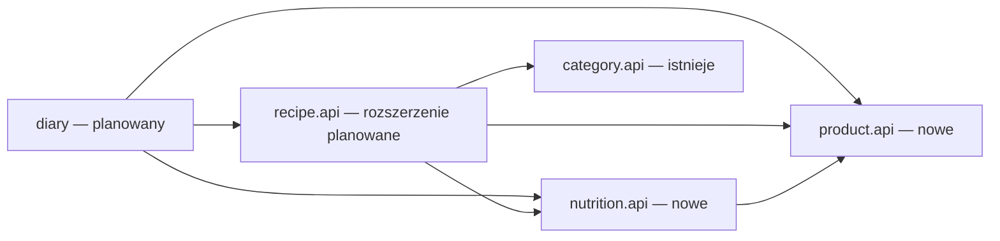

# E01 — fundamenty wielokrotnego użytku dla backendu i SwiftUI

Data: 2026-10-20. Status: projekt architektury do review; bez implementacji.
Źródło: [#10](https://github.com/kathelan/mealio/issues/10), [backlog](backlog.md),
[zakres MVP](2026-10-20-personal-mvp.md). Właściciel zaakceptował Q1: wspólna mapa
fundamentów i osobne wdrażalne SDD. Techniczne decyzje poniżej są propozycją tego PR.

## 📝 TLDR

E01 dostarcza katalog, obliczenia i skan oraz podstawy do ponownego użycia przez przepisy,
dziennik i klienta iOS. Każdy komponent powstaje wraz z pierwszym konsumentem, ma właściciela,
kontrakt i sprawdzalne granice. Ten dokument jest mapą architektury; implementację prowadzą
osobne SDD w tabeli, nie całe przekrojowe opracowanie naraz.

## 📝 Problem Statement

Właściciel chce rozwijać funkcje bez powtarzania mechanizmów ilości, wyboru produktu,
obliczeń i formularzy. Potrzeby potwierdzają konkretne stories, nie pomiar produktywności.
Przepisy i dziennik są planowanymi konsumentami, a nie już działającą integracją.

Dwa odczytowe przeglądy kodu wykazały: backend ma category/recipe/health i publiczny
[CategoryLookup](../../backend/src/main/java/com/mealio/category/api/CategoryLookup.java),
Clock, transakcje, testy ArchUnit i PostgreSQL. Product/nutrition/diary jeszcze nie istnieją.
[MeasurementUnit](../../backend/src/main/java/com/mealio/recipe/domain/model/MeasurementUnit.java)
i nullable calories w recipe są legacy; nie określają podstawy wartości produktu.
[Prototyp SwiftUI](../../ios-prototype%203/MealioPrototype.swift) ma jeden model aplikacji,
przykładowe dane i lokalne obliczenia. Inwentaryzacja nie wykazała targetu Xcode, testów iOS
ani klienta HTTP. To materiał o przepływach, nie gotowa biblioteka.

## 📝 Proposed Solution — katalog komponentów

Nazwy to docelowe role, nie obowiązek utworzenia osobnej klasy dla każdego wiersza.

| Element / kontrakt | Właściciel i pierwsza dostawa | Kolejni konsumenci | Korzyść i weryfikacja |
|---|---|---|---|
| Quantity, QuantityUnit, NutritionBasis, ServingConversion | product.api, #13 | #14/#15/#17/#21/#22 | Jeden kontrakt ilości i jawnych przeliczników; test 3 szt. po 55 g = 165 g |
| NutritionFacts, ProductSnapshot | product.api, #13 | #14/#15/#17/#20 | Niezmienny zestaw faktów z rewizją, nie encja; brak pola pozostaje Optional |
| ProductCatalog.findCurrent/findVersion i SearchProducts | product.api, #13 | #15/#17/#20/#21; UI #24–#28 | Konsumenci nie importują repository; testy z fake publicznego portu |
| NormalizeQuantity, lokalna implementacja czysta | product.api, #14 | #15/#17/#22 | Jedno przeliczenie jednostek; brak sieci/bazy; zgodne wymiary i brak konwersji testowane |
| NutritionCalculator.calculate | nutrition.api, #14 | #15/#17/#21/#22 | Obliczenia niezależne od HTTP/JPA; ten sam snapshot daje ten sam wynik |
| NutritionMath.scale/sum | nutrition.api, pierwsze użycie #15 | #17/#21/#22 | Zaprojektowany kontrakt dzielenia i sum częściowych; implementacja dopiero przy konsumentach |
| ProductRegistration — walidacja i zapis tożsamości/wersji | prywatne product.application, #13 | #20 | Wspólny zapis ręczny/potwierdzenia pod transakcją wywołującego; brak duplikacji invariants |
| ResolveBarcode i ConfirmExternalProduct | product.api, #20 | #25, wejścia z #26/#27 | Jeden przepływ potwierdzenia bez zależności diary; test lokalny wynik bez dostawcy |
| ExternalProductProvider | prywatny port product.application, #20 | adapter OFF, opcjonalny kolejny dostawca i fake | Podmiana integracji oraz testy błędów; nie staje się API innych domen |
| ApiErrorResponse / ApiErrorFactory / RequestIdFilter | techniczna infrastructure.web, #13 | adaptery nutrition i barcode | Spójny transport błędów; kody i mapowanie wyjątków pozostają modułowe |
| APITransport + URLSessionTransport | iOS Core/Networking, #24 | #25–#29 | Jeden mechanizm HTTP i dekodowania; feature adapters izolują DTO |
| ProductPicking / ProductSelection | iOS Features/Products, #24 | #25/#26/#27/#28 | Wynik wyboru bez skutku diary; dwa testowe hosty odbierają ten sam picker |
| QuantityInput + DecimalTextParser | iOS DesignSystem/Core/Formatting, #24 | #25–#29 | Tekst, lokalizacja i dozwolone jednostki; żadnego przeliczania kcal w UI |
| NutritionSummary | iOS DesignSystem, #24 | #25–#29 | Wyświetla wartości, podstawę i niekompletność z API; unknown nie jest zerem |
| AsyncContent / EmptyState / ErrorState | iOS DesignSystem, #24 | #25–#29 | Wspólna prezentacja stanu; źródło danych i retry dostarcza feature |
| FormField / FieldError / SubmitState | iOS DesignSystem, #24 | #25/#26/#28 | Zachowanie draftu i mapowanie błędów, bez silnika formularzy |
| IngredientRow / IngredientEditor | iOS Features/Recipes, dopiero #26 | #28/#29 | Kompozycja pickera i ilości; semantyka składnika pozostaje recipe |
| BarcodeScanner / BarcodeFlow | iOS Features/Barcode, #25 | wejścia #26/#27 | Aparat emituje kod; flow zwraca trwały produkt, nie wpis spożycia |

Każda SDD wskazuje minimalny pierwszy zakres. Kolejny konsument jest momentem weryfikacji
wspólnego kontraktu, a nie uzasadnieniem budowania zawczasu całego przyszłego modułu.

## 📝 Architecture — backend

Pozostaje jeden backend Maven i modularny monolit o architekturze heksagonalnej.
Właściciel doprecyzował użycie Springa jako technologii adapterów i konfiguracji.
Publiczne typy są framework-free,
w pakiecie api właściciela; obiekty HTTP i JPA pozostają przy adapterach.



Strzałka oznacza dozwoloną zależność, nie sekwencję wywołań. Product nie zależy od nutrition;
nutrition nie odczytuje katalogu w czystym kalkulatorze. Jego warstwa aplikacyjna może
pobrać snapshot przez product.api, normalizować ilość i przekazać dane do domeny obliczeń.
Normalizacja product jest czysta i wstrzykiwana jako NormalizeQuantity; nie tworzymy
podobnych przeliczników w recipe, diary ani SwiftUI. Recipe odpowiada za porcje i graf baz,
diary za fakt spożycia i datę, a product za tożsamość/rewizje i jednostki produktu.

Publiczne role (szczegóły w SDD):

- ProductCatalog: Optional<ProductSnapshot> findCurrent(UUID), findVersion(UUID, UUID).
- SearchProducts: strona danych po nazwie; to nie port dostawcy zewnętrznego.
- NormalizeQuantity: BaseQuantity normalize(Quantity, ProductSnapshot); błąd przy braku
  konwersji lub wymiarze, nie wynik PARTIAL.
- NutritionCalculator: CalculationResult calculate(NutritionFacts, BaseQuantity).
- NutritionMath w #15: scale(result, dodatniFactor), sum(results); nie zależy od recipe.
- ResolveBarcode: rozłączny lokalny produkt / kandydat / brak / niedostępność / limit.

### Heksagon i Spring — jawne granice

```text
infrastructure.web.Controller -> api.InboundPort -> application.UseCase -> domain
                                                       |
                                                       v
                                            application.port.out.OutputPort
                                                       ^
                                                       |
                                   infrastructure.persistence/provider.Adapter
```

- Nowe product/nutrition api, application i domain nie importują Spring/JPA/HTTP.
  Port wejściowy należy do api, port wyjściowy do application.port.out. Adapter implementuje
  port, a przypadek użycia dostaje go przez konstruktor. Domain nie zna portów transportu.
- infrastructure.config zawiera Spring @Configuration/@Bean i składa graf zależności.
  Kontrolery są @RestController, adaptery JPA używają Spring Data, dostawcy klienta HTTP.
  Application nie wyszukuje beanów i nie woła ApplicationContext.
- Granica transakcji odpowiada całemu przypadkowi użycia. Infrastrukturalny adapter
  transakcyjny implementuje ten sam port wejściowy i obejmuje delegację do czystego use case
  przez TransactionTemplate (lub Spring transactional proxy w adapterze). Tylko dekorowany
  port jest wystawiany jako bean. Testy dowodzą wspólnego commit/rollback wszystkich zapisów;
  transakcja pojedynczego repository nie zastępuje transakcji przypadku użycia.
- ResolveBarcode nie trzyma transakcji podczas zewnętrznego HTTP. Osobne krótkie granice
  obejmują zapis snapshotu kandydata oraz atomowe potwierdzenie. Odczytowe adaptery materializują
  cały snapshot przed zamknięciem transakcji, bez lazy encji wypływających do application.
- Testy unit konstruują core bez Springa. Integracje sprawdzają wiring port -> dekorator ->
  use case -> adapter i rzeczywistą transakcję. ArchUnit dla nowych modułów blokuje Spring/JPA
  w api/application/domain oraz bezpośredni dostęp do adapterów. Istniejący recipe/category
  pozostaje bez zmiany; ich obecne adnotacje aplikacyjne nie są migrowane przy tej funkcji.

Metody zapisu to nazwane przypadki użycia RegisterProduct/ReviseProduct, nie ogólny serwis CRUD.
Repozytoria są prywatnymi portami do testowania i wymiany persystencji. Złożone obiekty
powstają builderami walidującymi niezmienniki, proste typy nazwanymi fabrykami.

Wspólna infrastruktura webowa nie jest domeną. Tylko adaptery zależą od technicznego
ApiErrorFactory; domenowe wyjątki i ich znaczenie należą do właścicieli. Istniejące
ApiErrorResponse category/recipe zostają zgodne: ewentualne dodanie requestId/violations
jest addytywne i testowane. Obsługa nowych błędów nie zmienia statusów legacy.

Mechanizmy już dostępne: Clock, constructor injection, Spring transactions, Liquibase,
PostgreSQL Testcontainers i ArchUnit. Rozwijamy ich istniejące użycie. Brak podstaw
na wspólną hierarchię encji/repozytoriów, własny kontener DI, bus lub osobny framework Maven.

## 📝 Architecture — iOS

Jeden target aplikacji, target unit tests i UI tests, iOS 17+, SwiftUI oraz Foundation.
Docelowe pliki `ios/Mealio.xcodeproj`, współdzielony scheme Mealio. Żadne nowe zależności
architektoniczne nie są konieczne dla pierwszego przepływu.

```text
ios/Mealio/
  App/                 konfiguracja, składanie zależności, nawigacja
  Core/Networking/     APITransport, URLSessionTransport, transportowe błędy
  Core/Formatting/     DecimalTextParser, formatowanie dla locale
  DesignSystem/        komponenty prezentacyjne i semantyczne tokeny
  Features/Products/   picker, formularz, view modele, porty i adapter produktów
  Features/Barcode/    flow i adapter aparatu, dodane przez SDD skanera
```

Widok -> @MainActor ViewModel -> wąski port funkcji -> adapter endpointów -> APITransport.
DTO należą do adaptera funkcji. URLSession nie zna Product, a komponent DesignSystem
nie wysyła żądań. Wstrzyknięcie portów pozwala testować feature bez HTTP i symulatora.
ViewModel z Observation jest właścicielem stanu ekranu; aplikacja nie ma jednego wspólnego
MealioModel łączącego katalog, przepisy, dziennik i obliczenia.

ProductSelection zawiera productId/versionId i opcjonalną ilość, zależnie od trybu.
Wywołujący decyduje, czy tworzy składnik lub wpis. Utworzenie produktu jest osobnym
skutkiem katalogowym. Anulowanie pickera nie zapisuje spożycia.

## 📝 Data Model i reguły wspólne

Ten dokument ustala właścicieli i formaty, nie dodaje tabel. Model katalogu i kandydatów
z diagramami jest w odpowiednich SDD poniżej. Snapshot spożycia i graf baz pozostają
własnością przyszłych SDD recipe/diary.

Źródłowe liczby i ilości: BigDecimal, wejście do 12 cyfr łącznie, maksymalnie
6 cyfr części całkowitej i 6 miejsc dziesiętnych,
nieujemne fakty i dodatnie ilości/przeliczniki. BaseQuantity jest odrębnym typem wyniku
normalizacji, do 24 cyfr/12 miejsc, a nie ponownie walidowanym wejściowym Quantity. Normalizacja mnoży dokładnie;
obliczenia na 100 przesuwają skalę dokładnie. Nigdy double.
Propozycja przyszłego dzielenia na porcje: DECIMAL128/HALF_EVEN, wynik snapshotu 6 miejsc;
UI do 2 miejsc, bez ponownego użycia zaokrąglonego napisu jako wejścia. Doprecyzowanie
wdraża SDD #15, gdy pierwszy raz pojawi się dzielenie przez liczbę porcji.

Nowe endpointy przesyłają ułamki jako kanoniczne napisy dziesiętne z kropką, bez exponentu;
nie zmienia to reprezentacji obecnego API recipe. Brak pola w JSON to null/pominięcie
według schematu, na granicy Java mapowany na Optional. E01 nie przelicza energii z makro.
Pełne cztery pola to COMPLETE, brak dowolnego to PARTIAL. Dla niepustej sumy bez znanych
wartości danego pola wynik pozostaje nieznany; pusty dziennik ma osobną semantykę zerową.
Sumowanie metadanych składników nie może zmieniać liczby wpisów dziennika: potrawa to jeden wpis.

Historia konsumuje jawny versionId i utrwalony wynik. Zmiana danych nie modyfikuje rewizji.
Nie przenosimy legacy recipe.calories do faktów PER_100_G bez źródła lub decyzji o migracji.

## 📝 API Contracts, UI/UX i failure modes

Kontrakty HTTP projektują osobne SDD; przy implementacji aktualizują OpenAPI w tej samej
zmianie. Błędy nowych operacji: code/message/timestamp/requestId oraz opcjonalne violations.
Wynik niekompletny jest poprawnym wynikiem z metadanymi, nie błędem transportu.

UI przechowuje draft liczby jako tekst i parsuje Decimal w locale. Brak nie staje się zerem,
a błędna ilość nie staje się 100. Wynik obliczenia pochodzi z backendu. Wyszukiwanie i preview
anulują poprzednie zadanie i sprawdzają generację odpowiedzi. Zapisu nie ponawiamy automatycznie
po niejednoznacznym błędzie; skaner ma jawny kontrakt idempotencji.

Odczyt ma loading/empty/content/error, zapis zachowuje draft przy błędzie i blokuje równoległy
submit. Komponenty mają VoiceOver, Dynamic Type i czytelne etykiety jednostek. Tokeny opisują
role koloru/typografii/odstępów, a nie zatwierdzony finalny wygląd. Mockupy wymagają osobnej
rozmowy i akceptacji; ten PR ich nie tworzy ani nie zastępuje.

## 📝 Risks & Impact Review

- Kontrakty publicznych typów utrudniają późniejsze zmiany: eksportujemy tylko typy używane
  przez pierwszego konsumenta; nowy konsument wymaga testu zgodności, nie dostępu do wnętrza.
- Legacy enum i calories nie są źródłem prawdy: #15 ma osobną zgodną migrację. E01 nie łączy
  przenoszenia legacy z wprowadzaniem katalogu.
- Docelowy target iOS trzeba utworzyć i zweryfikować; zapis pliku Swift nie jest działającą aplikacją.
- Nieznane wartości i spóźnione odpowiedzi mogą fałszować UI: wymagane testy obu przypadków.
- Product jest bez auth wyłącznie lokalny/kontrolowane demo; brak userId zgodnie z ADR-0003.

D01/D08–D11, R01–R03/R06–R08 i N01/N03 z briefu są zachowane. Q02 kalkulatora nie dotyczy
tego projektu; Q1 podziału dokumentów został rozstrzygnięty przez właściciela. Nie wprowadzamy
AI, auth, współdzielenia ani Garmin. Sztuki są zatwierdzonym rozszerzeniem zakresu R03;
SDD katalogu wymaga jawnego dodatku do ADR-0005 przy implementacji.

## 📋 Phasing — osobne specyfikacje

| SDD | Wynik / główny issue | Pierwsze fundamenty | Zależność |
|---|---|---|---|
| [Katalog](2026-10-20-e01-product-catalog.md) | produkt raz zapisany i ponownie znaleziony, #13 | publiczne fakty/ilości, wersje i błędy HTTP | brak |
| [Obliczenia](2026-10-20-e01-nutrition-calculation.md) | ilość -> powtarzalne kcal/makro, #14 | normalizacja i czysty kalkulator | katalog |
| [iOS i wybór produktu](2026-10-20-e01-ios-product-foundations.md) | uruchamialny klient i formularz, #24 | transport, stany, picker, pola i summary | katalog; preview po obliczeniach |
| [Skan](2026-10-20-e01-barcode-resolution.md) | skan -> lokalny produkt lub potwierdzenie, #20/#25 | port dostawcy i zwracający wybór flow | katalog, iOS dla części aparatu |

Są to spójne zakresy funkcjonalne, nie jeden wielki projekt techniczny. Kolejne #15/#16/#17/#21/#22/#23/#26/#27/#28/#29
reuse opisują jako planowanych konsumentów; ich implementacja nie jest objęta E01.
#20/#24/#25 należą do zakresów E01 opisanych powyżej.

## 📋 Implementation Plan — sposób realizacji mapy

1. W kolejności zależności przygotować implementacyjny PR z jednej SDD, kontraktem i testami.
2. W tej samej dostawie uruchomić pierwszy feature oraz fundamenty faktycznie przez niego używane.
3. Sprawdzić granice ArchUnit/portów i testy feature. Dla Java: 100% linii Surefire,
   integracje PostgreSQL, architektura i mvn clean verify. Dla iOS: build/unit/UI tests oraz
   scenariusze na symulatorze; aparat dodatkowo na urządzeniu, gdy jest potrzebny.
4. Przy kolejnym konsumencie udowodnić reuse testem integracyjnym lub dwoma hostami UI;
   rozszerzyć publiczny kontrakt addytywnie, zachowując wcześniejszego konsumenta.
5. Po wdrożeniu konkretnej SDD przenieść ją do implemented; mapa pozostaje dokumentem
   projektowym do czasu wykonania wszystkich wskazanych zakresów. Plan nie uruchamia kodowania.

## 🧪 Kryteria akceptacji projektu

- Każdy element tabeli ma właściciela, pierwszego/kolejnego konsumenta i sprawdzalną korzyść.
- Diagram zależności jest acykliczny, a domeny/klient nie odtwarzają cudzych reguł.
- Cztery SDD mają własne API/flow, failure modes, plan testów i osobne kroki dostawy.
- Nie ma pustych bazowych serwisów, sztucznych domen ani zmian istniejących kontraktów bez przejścia.
- Review dokumentów nie jest przedstawiane jako wykonane testy przyszłej implementacji.

Badania i uzasadnienia: [notatka źródłowa](research/2026-10-20-e01-foundations-research.md).
[Review i zamknięte ustalenia](research/2026-10-20-e01-foundations-review.md).
