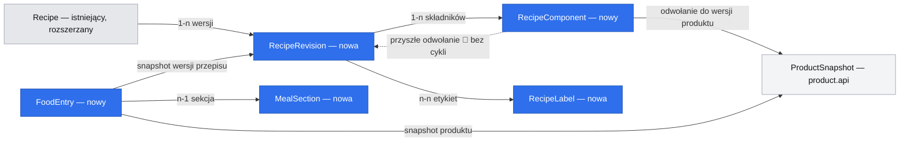

# E02 — potrawy wielokrotnego użytku i dziennik

## 📝 TLDR

E02 łączy zapisane przepisy z dziennikiem dnia i tygodnia. Ta mapa dzieli epic #11 na
samodzielnie wdrażalne SDD: podstawy przepisów, własne sekcje, dziennik oraz późniejsze
rozszerzenia przepływów. Receptura jest szablonem; zapis spożycia jest pojedynczym wpisem
z wartościami i wersją użytymi w chwili dodania.

## 📝 Problem Statement

Właściciel chce ponownie zapisywać znane potrawy i szybko rejestrować porcję bez odtwarzania
składu. Issue #11 obejmuje zarówno przepisy, jak i dziennik, a jego stories mają różne
zależności. Brief i potwierdzone decyzje D09–D11 określają porcje, personalizację oraz
możliwość użycia przepisu jako składnika; nie są dowodem na zmierzoną oszczędność czasu.

## 📝 Proposed Solution

Mapę traktujemy jako plan granic i kolejności zależności, nie wspólne wdrożenie wszystkich
stories. Każda niezależna funkcja dostanie własną SDD z kontraktem, modelem i testami.
Przepis zapisuje składniki z wybranych wersji produktów i udostępnia wynik przez `recipe.api`.
Moduł `diary` zapisuje jeden wpis na produkt lub porcję przepisu i pobiera dane wyłącznie
przez publiczne API `product`, `nutrition` i `recipe`.

OpenNutriTracker łączy wyszukiwarkę składników, edytor receptury i wartości na porcję;
Mealio może reuse'ować wybór produktu, zachowując obliczenia w backendzie. Jego dziennik
korzysta z konfigurowalnego podziału posiłków. W E02 personalizacja sekcji jest regułą
produktu, a płaskie etykiety przepisu pozostają od nich niezależne.
Źródła: [OpenNutriTracker — funkcje i wiki](https://github.com/simonoppowa/OpenNutriTracker/wiki),
[Kcal — model przepisów i dziennika](https://github.com/kcal-app/kcal).

## 📝 Architecture

`recipe` rozszerza istniejący moduł i pozostaje właścicielem szablonów, etykiet i obliczeń
ich składników. `diary` jest nowym właścicielem sekcji oraz wpisów spożycia. `diary` może
wywołać `recipe.api`, np. przy zapisie wybranych wpisów jako przepisu; `recipe` nie importuje
`diary`, dzięki czemu zależności są acykliczne. Oba moduły korzystają z wersji produktów
przez `product.api` i z czystych funkcji sumowania/skali przez `nutrition.api`.

Istniejąca `category.api` i hierarchiczne kategorie pozostają odrębne od płaskich etykiet
przepisu i własnych sekcji dnia. Zmiany w istniejącym `recipe` ograniczamy do koniecznych dla
tej funkcji; refaktoryzacja legacy nie wchodzi do zakresu. Spring składa adaptery, a nowe
porty i domeny pozostają wolne od frameworków. API, Liquibase i wersjonowanie szczegółowo
opisuje każda story-SDD.

## 📝 Data Model

Model koncepcyjny do potwierdzenia w poszczególnych SDD. `Recipe` i `RecipeIngredient` już
istnieją w module `recipe`; ich migracja lub rozszerzenie wymaga osobnej, addytywnej migracji.
SDD #15 definiuje niezmienną `RecipeRevision` z liczbą porcji oraz składnikami wskazującymi
wersje produktów, tak by #17 mogło utrwalić użyty skład i wyliczenie. `RecipeLabel` jest
płaską etykietą, niezależną od `MealSection`. Dopiero #22 dodaje składniki odwołujące się do
innych `RecipeRevision` i blokadę cykli; ta relacja jest planowana, nie częścią #15.

`MealSection` przechowuje własną nazwę i kolejność. Startowy zestaw to śniadanie, drugie
śniadanie, obiad, lunch, kolacja i przekąski. Właściciel potwierdził 2026-10-20, że osoba
może zmienić nazwy i liczbę sekcji, np. prowadzić tylko trzy posiłki. `FoodEntry` wskazuje
produkt albo wersję przepisu, sekcję i datę `LocalDate`; przechowuje ilość i snapshot wyniku
żywieniowego, by późniejsza edycja szablonu lub produktu nie zmieniała historii.

Takeaway: `FoodEntry` utrwala użyty wynik i wersję, a przyszłe zmiany receptury nie
przeliczają historii. Diagram jest modelem kierunkowym; fizyczne klucze i migracja legacy
zostaną potwierdzone przez SDD właściciela danych.

## 📝 Edge Cases & Failure Scenarios

- Braki wartości pozostają jawne; częściowego wyniku nie prezentujemy jako pełnego (R02).
- Brak przelicznika jednostki nie pozwala zgadywać masy ani objętości (R03/ADR-0005).
- Zmiana wody nie zmienia kalorii; masa końcowa przepisu jest opcjonalna.
- Parametr ilości składnika pyta o ilość na jedną porcję; wybrana liczba porcji skaluje
  ilości tylko dla bieżącego dodania i nie zmienia szablonu.
- Użycie przepisu jako składnika nie może tworzyć cyklu ani odwołania do zmiennej wersji.
- Zapis wpisów jako przepisu nie dodaje ponownie spożycia ani nie zmienia bilansu dnia.
- Tydzień obejmuje jawne dni kalendarzowe; strefa serwera nie przesuwa `LocalDate`.

## 📝 Decisions in play

- D09, R06: liczba porcji przepisu jest wymagana; parametr składnika podaje ilość na jedną
  porcję; zmiany przy dodawaniu nie zmieniają szablonu.
- D10, R08: własne sekcje i płaskie etykiety są niezależne.
- D11: przepis może być składnikiem innego przepisu.
- R02/ADR-0006 i R03/ADR-0005: zachowujemy jawne braki i jawne konwersje.
- ADR-0004 uzgodniono z potwierdzonym zestawem domyślnym: śniadanie, drugie śniadanie,
  obiad, lunch, kolacja, przekąski; nazwy i liczba sekcji są konfigurowalne.
- ADR-0003/N01 pozostaje w mocy: brak kont, `userId` i pozorowanej izolacji w MVP.

## 📋 Phasing

| Story | Osobny zakres do SDD | Zależności |
|---|---|---|
| #15 | Biblioteka i zapis przepisów, porcje, składniki, płaskie etykiety | E01 #13 i #14 |
| #16 | Własne sekcje dnia z powyższymi domyślnymi wartościami | brak |
| #17 | Wpis produktu/przepisu, porcje, bilans dnia i tygodnia | #15, #16 |
| #21 | Pytanie o ilości wybranych składników przy dodaniu przepisu | #15, #17 |
| #22 | Własny przepis jako składnik, wersjonowanie i kontrola cykli | #15, #14 |
| #23 | Utworzenie przepisu z wybranych wpisów bez ponownego spożycia | #15, #17 |

Każda pozycja jest osobno wdrażalna po swoich zależnościach; mapa nie przesądza kolejności
poza tym grafem. UI stories #26–29 pozostają przy odpowiadających im przepływach.

## 📋 Implementation Plan

1. Przygotować story-SDD dla #15, #16 i #17 z API, stanami UI, modelem zmian i kryteriami
   testowalnymi; zakres sekcji jest już uzgodniony z ADR-0004.
2. Dla każdej nowej funkcji zachować granice `recipe`/`diary`, zależności publiczne i testy
   jednostkowe 100% linii; nowe API dokumentować w OpenAPI.
3. Rozszerzenia #21–23 otrzymują osobne SDD, które sprawdzają skrajne przypadki ilości,
   wersji i braków. #22 dodaje test odrzucenia cyklu, #23 test braku drugiego wpisu.
4. Implementacja Java wymaga PostgreSQL, testów integracyjnych/architektury i pełnego
   `mvn clean verify`; UI wymaga testów i QA na symulatorze zgodnie z instrukcjami repozytorium.

Każdy krok wdrożenia ma zostawić aplikację uruchamialną. Mapa nie autoryzuje implementacji.
